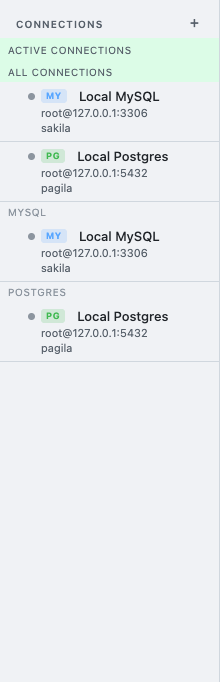
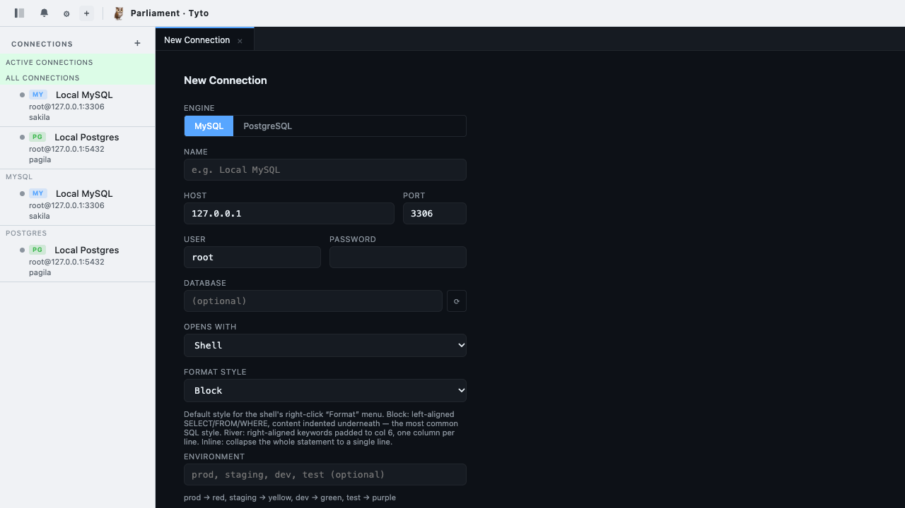
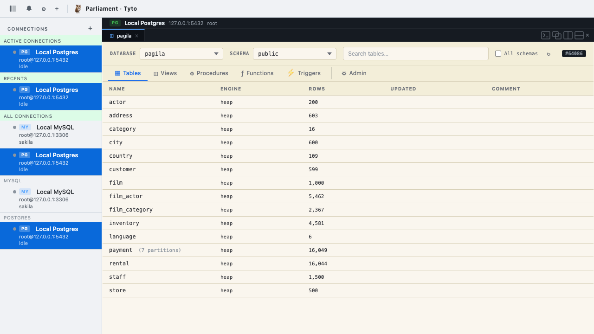
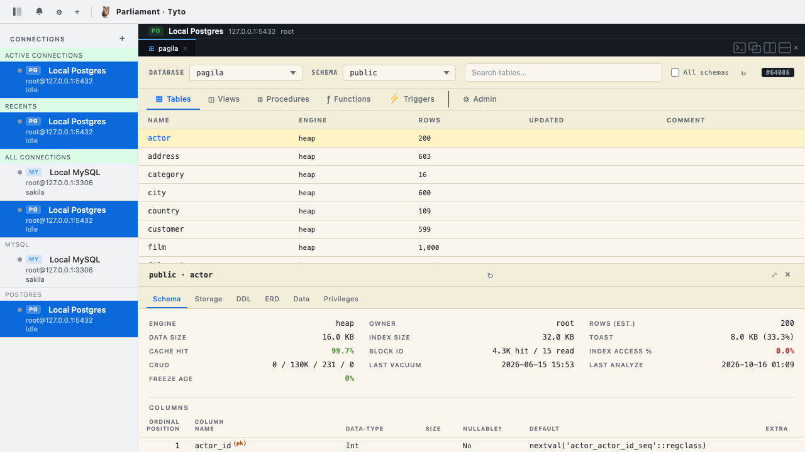
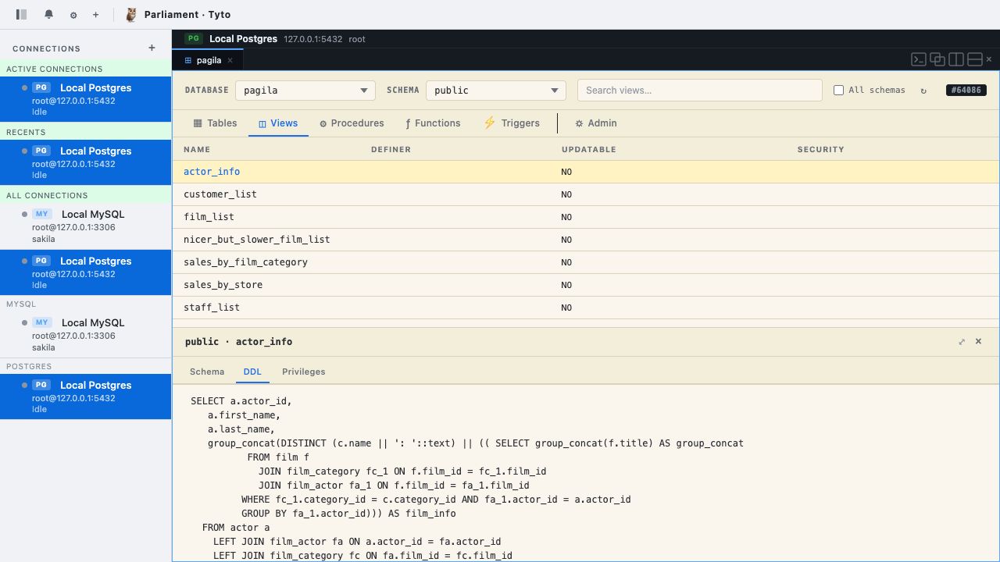
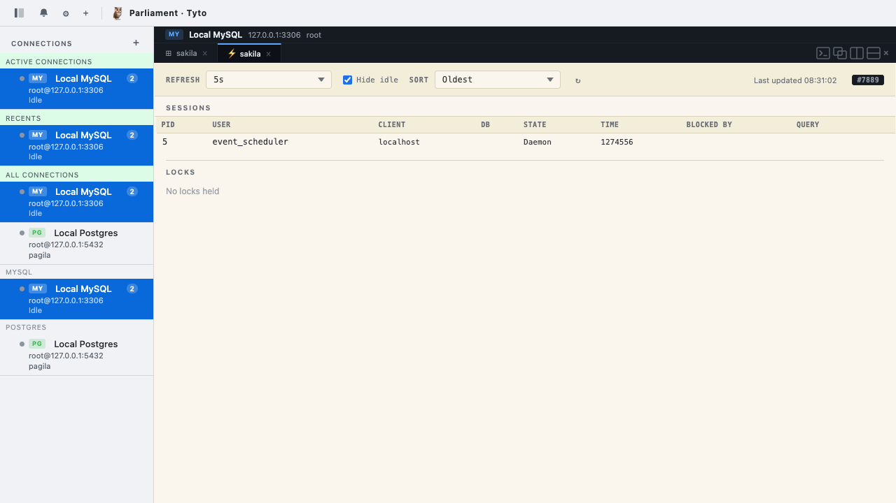
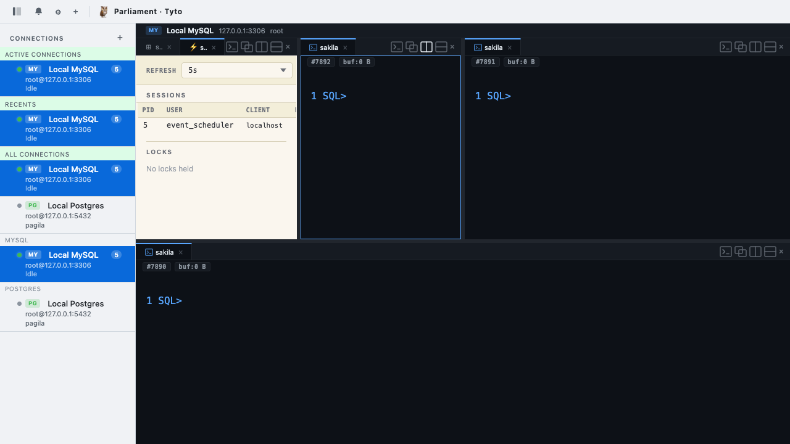
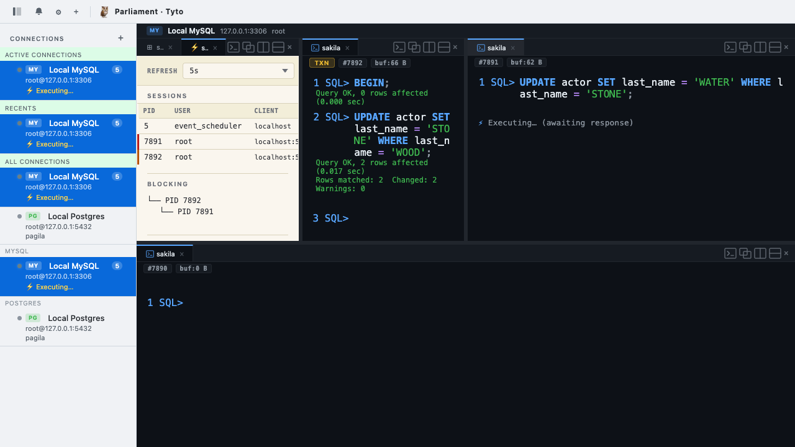

# 🦉 Parliament

I've spent four decades in databases, most of them at a terminal in `psql`, `mysql`, or other database CLIs. The tools that got me closest to feeling at home in a database were the ones that stayed out of my way.

Parliament is the database client I finally got tired of waiting for. It runs in a browser tab, it behaves like the shells that I love, and it speaks the native SQL dialect and other commands of the databases that I know and love. Additionally these shells share the screen with proper schema explorers and activity viewers (with additional GUI panels coming soon!) — no desktop app required.

---

## What Parliament is

Parliament is a browser-based database client. Today it gives DBAs the shell experience they know from `psql` and `mysql`. Near-term, it will fill a gap that matters — a secure database client that fits inside complex environments, working with the security architectures organizations already rely on.

It's built for people who think in SQL, reach for the keyboard before the mouse, and want a proper tool for serious database work. That's DBAs, data engineers, anyone on-call for a database at 2 a.m. If you've ever opened `psql` to avoid opening a GUI, Parliament is aimed at you.

The project supports MySQL and PostgreSQL today, with SQLite, MariaDB, AWS Redshift, Snowflake, Databricks, and MongoDB on the roadmap. Deep coverage of each database's dialect and metadata is the bar; faithful reproduction of the native CLI experience in the browser is the goal.

---

## Built with Claude Code

Parliament was built with Claude Code as a working partner throughout. That covers every phase: architecture discussions, writing Rust and TypeScript, writing and running tests, and drafting documentation — including a first pass at this document. The code that ships is reviewed and signed off by me; Claude drafts, I refine.

There are two reasons this sits here and not buried in a footnote. First, it's relevant to how you read what follows: Parliament is a solo developer's project expressed through deliberate use of an AI collaborator. Second, how this tool was built is part of the story. Good results from Claude Code require treating it as a capable peer, not a word generator — and the results in Parliament reflect this.

---

## How it's put together

Parliament is three tiers: a browser, a Rust backend, and whatever database you're working with.

```
┌──────────────────────┐   WebSocket    ┌──────────────────────┐    TCP    ┌─────────────────────┐
│  Tyto  (browser)     │ ◀────────────▶ │  Noctua  (server)    │ ◀───────▶ │  MySQL / PostgreSQL │
│  Leptos → WASM       │                │  axum + sqlx, Rust   │           │                     │
└──────────────────────┘                └──────────────────────┘           └─────────────────────┘
```

### Tyto — the frontend

Tyto is the browser side — a Leptos application compiled to WebAssembly. It speaks to Noctua over a WebSocket and to nothing else. Tyto holds no database credentials and knows nothing about the MySQL or Postgres wire protocols; that's entirely the backend's responsibility.

What Tyto brings is a DBA-native feel — a shell that tracks command history, splittable panes, multiple tabs, schema explorer, activity viewer — running at WASM speed inside any modern browser. The only install step is whatever browser you already have open.

### Noctua — the backend

Noctua — the backend — has been deployed and tested in a single-node configuration: one Noctua process holds a set of connection profiles, serves Tyto browser sessions, and keeps each pane's database connection pinned to its own session so transactions, temporary tables, and session variables behave the way a DBA expects.

Near-term, Noctua gains multi-profile support: pluggable credential providers, session recording, and access-policy hooks. The goal is a browser-native database client that plugs into PAM and other enterprise security architectures — so teams can adopt it alongside the security posture they already have in place.

---

## A 30-second tour

Parliament opens to a sidebar on the left listing your saved connections, and an empty workspace on the right waiting for a connection to be selected.



Adding a connection is a short form: connection name, database engine, host, port, username, password, optional default database. Parliament saves the profile locally and offers sensible defaults per engine — Postgres on 5432, MySQL on 3306, localhost if you don't fill anything in.



Click a connection in the sidebar and its workspace opens. Each connection owns its own workspace — its own layout, its own tabs, its own command history. Switching connections doesn't disturb the one you just left. If you want two databases open side by side, open them both and use the sidebar to bounce between.


Inside a workspace, you build up whatever layout the task calls for. The tab bar has controls for adding a new shell, splitting the pane horizontally or vertically, and converting a pane into a Schema Explorer or Activity viewer. Splits are draggable; panes remember what they're showing. A typical working layout for me is one Activity Pane across the top, a Schema Explorer pinned in a side column, and one or two shells filling the rest.


---

## SQL Shell

Parliament's shell is what most of my day looks like. It's a real shell — not a query editor dressed up as one.

It uses the keystrokes and commands you already know. That includes readline edit keys (`Ctrl-A`, `Ctrl-E`, `Ctrl-U`, `Ctrl-K`, `Ctrl-W`), history-walking arrow keys with prefix matching (type `SELECT` and press up-arrow to filter history to SELECT queries), and `Ctrl-R` reverse-incremental search. `Shift-Enter` adds a newline; `Enter` on `;` or `\G` submits.

The shell speaks 24 `\d*` metadata commands today — `\dt`, `\di`, `\dv`, `\df`, `\dn`, `\dx`, and so on — with the full `psql` set as the target we're building toward. Additional meta-commands include `\sf` / `\sv` / `\ef` / `\ev` for function and view source, `\c dbname` for real reconnection, `\timing`, `\watch N`, `\safe-mode on` (inline confirmation gates for `DROP` and `TRUNCATE`), `\set` and `:var` substitution, and the full `\pset` family for output formatting. Where a feature isn't shipped yet, we name the gap rather than hide it.

Multiple statements on paste — `SELECT 1; SELECT 2; SELECT 3;` — run in order, continuing past an error as `psql` and `mysql` do. The parser understands MySQL `DELIMITER //` for stored-procedure authoring and Postgres dollar-quoted strings so `$$ ... $$` function bodies don't split on internal semicolons.

Beyond shell interaction, Parliament adds things a browser can offer that a terminal can't: save results as CSV, JSON, or SQL from any result block; split a shell pane horizontally or vertically to work with two database sessions side by side (each session is pinned to its own backend connection, so temp tables and transactions behave); and persistent command history that survives a page refresh or a crash — fish-style deduplication, keyed per connection.

Deep dialect coverage is the bar. Faithful native-CLI reproduction in the browser is the goal.

---

## Schema Explorer

The Schema Explorer sits next to the shell in the same workspace. Open it as a pane and it shows a schema dropdown, an object-type selector (tables, views, indexes, functions, triggers, and the rest), a flat list of objects, and an inline inspector below the list.



Click a table in the list and the inspector opens its details: columns with types and nullability, indexes with their key columns, and — for PostgreSQL — a reconstructed `CREATE TABLE` statement built from `pg_catalog`. The reconstructed DDL is the real thing: defaults, constraints, comments.



Views get the same treatment: columns on the Schema tab, plus the view definition itself rendered from `pg_get_viewdef` on the DDL tab. Functions and stored procedures show their source via `pg_get_functiondef`. Triggers show their attached table, event, and function. Everything the shell's `\d*` meta-commands surface, the Schema Explorer shows graphically.



The Schema Explorer's cache invalidates when DDL runs in an adjacent shell. Run `CREATE TABLE` in the shell, the table list refreshes. Run `DROP VIEW`, the view disappears. Schema and shell don't drift.

---

## Activity Pane

The Activity Pane shows what's happening on the database right now — all sessions, all running queries, and who's blocking whom.



The most useful feature of an activity viewer is helping you see the thing you don't want to see: a session stuck behind a lock. Here's a scenario that demonstrates it — three shells arranged in the bottom row of the workspace, an Activity Pane filling the top.



In the first shell, I run:

```sql
BEGIN;
UPDATE actor SET last_name = 'STONE' WHERE last_name = 'WOOD';
```

Two rows updated. The transaction is open; I haven't committed.

In the second shell, I run:

```sql
UPDATE actor SET last_name = 'WATER' WHERE last_name = 'STONE';
```

That second statement needs a row lock that the first transaction is holding. It doesn't error — it waits. The shell shows a pending indicator and stays that way as long as the first transaction remains uncommitted.

Five seconds later, the Activity Pane refresh picks up the block:



The blocking session shows up clearly. The blocker tree tells you exactly who's waiting on what. A kill-query action sits next to the blocked session so you can resolve the situation if that's the right move — with an inline confirmation gate, because ending a running query is exactly the kind of thing where a confirmation gate pays for itself.

Activity refresh is configurable — manual, 1s, 2s, 5s, 10s, 30s, or 60s. The pane also shows long-running queries, idle connections, and other things that usually hide inside `SHOW PROCESSLIST` output.

---

## What's next

A few pieces of the product are explicitly unfinished today. Here's what's coming.

**GUI DDL in the Schema Explorer.** Today the Schema Explorer is read-only: it shows you what's there. The next step is editing — adding columns, creating indexes, altering constraints, creating tables from scratch — without leaving the pane.

**Data exploration and editing.** A proper grid view with in-place edit for the common case of "I need to fix one row right now," plus a wide-column projection for tables you can't usefully display in a flat grid.

**Permissions Explorer.** Every database has its own model for managing access. PostgreSQL has roles, grants, row-level security, default privileges, and column-level grants. MySQL has user accounts and per-object grants. Others differ again. A unified interface for searching what's been granted to whom, examining from an object point of view or a user point of view, and modifying — without requiring the user to know the native grant syntax of the database they're working in.

**Performance monitoring.** There's something I've been working on here that I'm not ready to talk about yet. It's the piece I'm most excited about. More when it's ready.

---

## Credits & acknowledgments

Parliament was built in partnership with Claude Code[^claude]. Every section of this document was drafted collaboratively. Playwright[^playwright] is used to assist with some end-to-end testing of the frontend.

The look and feel of Parliament's shell owes inspiration to CMUX[^cmux], which has set a bar for what a modern terminal experience can be. Thanks to that team for showing what good looks like.

[^claude]: Claude Code — <https://claude.ai/code>
[^playwright]: Playwright — <https://playwright.dev>
[^cmux]: CMUX — <https://cmux.com>
