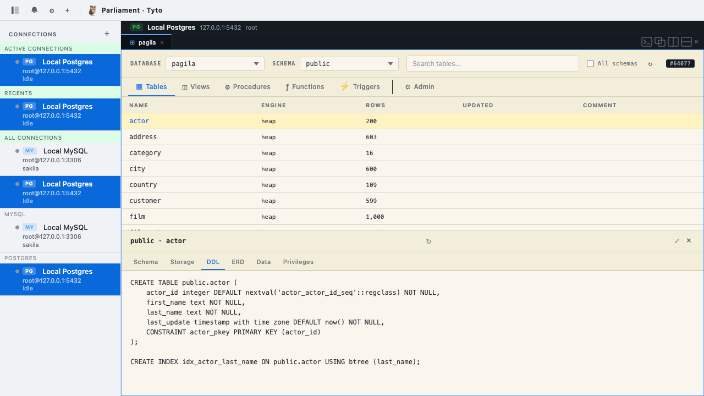

# Parliament

[](https://github.com/parliament-labs/parliament/actions/workflows/ci.yml)

Parliament is a browser-based SQL client built entirely in Rust with great assistance from Claude Code. It compiles to WebAssembly, runs in any modern browser, and feels native to DBAs who live in `psql` and `mysql`.

The project is named after the collective noun for a group of owls. Its components are **Tyto** (the barn-owl frontend, genus *Tyto*) and **Noctua** (the little-owl backend, genus *Noctua* — Athena's owl). See [`vault/Parliament/NAMING.md`](vault/Parliament/NAMING.md) for the naming rationale.

## What is this?

Parliament is a three-tier SQL client that brings the power of a native terminal shell to the browser — without Electron, without a desktop app, without compromises. The backend holds database connections; the frontend is pure WASM. DBAs get the commands they know (`\dt`, `\sf`, `\watch`, `\safe-mode`) with browser-native conveniences (save-as download, resizable splits, persistent history, inline confirmation gates).

## Install

One binary, nothing else to install. On a Mac (Apple Silicon):

```bash
curl -fsSL https://github.com/parliament-labs/parliament/releases/latest/download/parliament-aarch64-apple-darwin.tar.gz | tar -xz
./parliament-aarch64-apple-darwin/noctua
```

On Linux, use `parliament-x86_64-unknown-linux-gnu` or `parliament-aarch64-unknown-linux-gnu` instead (glibc 2.35+ and OpenSSL 3). Then open http://localhost:3000 and add a connection with the **+** in the sidebar. Every release is on the [releases page](https://github.com/parliament-labs/parliament/releases).

- Parliament runs on your own machine, for you alone: noctua listens on 127.0.0.1:3000 only.
- Saved connections, passwords included, are kept in `~/.sqlclient/connections.json`, readable by you alone. Postgres connections can take their password from `~/.pgpass` instead.
- The binaries aren't signed. macOS blocks one downloaded through a browser; `xattr -dr com.apple.quarantine parliament-aarch64-apple-darwin` lets it run. A `curl` download isn't affected.

## Features

### SQL Shell

- **Full psql / mysql meta-command support** — ~50 `\d*` metadata commands, `\sf`/`\sv`/`\ef`/`\ev` function/view source, `\g` / `\gx` execute-buffer, `\c [dbname]` as psql does it (previous connection kept if the new one fails), `\conninfo`, `\encoding`, `\echo`, `\copyright`, `\errverbose`, `\set`/`:var` variable substitution, and more
- **Multi-statement execution** — paste `SELECT 1; SELECT 2; SELECT 3;` and all three run in sequence, continuing past an error as psql and the mysql CLI do (`\set ON_ERROR_STOP on` stops on Postgres)
- **DELIMITER support** (MySQL) — `DELIMITER //` enables stored-procedure authoring from the shell
- **Dollar-quote awareness** (Postgres) — `$$ ... $$` function bodies don't split on internal semicolons
- **`\watch N`** — auto-repeat the last query every N seconds with a live-updating result block
- **`\safe-mode on`** — destructive commands (`DROP TABLE`, `TRUNCATE`, etc.) require inline confirmation before executing
- **`\x` expanded toggle** — sticky vertical output mode (psql's `\pset expanded`)
- **`\output format`** — switch between table, vertical, CSV, JSON, Markdown, HTML, AsciiDoc, and LaTeX output per session
- **`\timing`** — toggle execution time display
- **`\h KEYWORD`** — SQL syntax help with links to official documentation
- **`\set` / `:var`** — client-side variable substitution (`:name`, `:'name'`, `:"name"`)
- **Transaction state indicator** — yellow "TXN" badge when inside `BEGIN`; red "TXN FAILED" for Postgres's aborted-transaction state

### SQL Shell Query History

- **Persistent across sessions** — history survives page refresh, crashes, and battery death (localStorage, persist-on-submit)
- **Prefix-matching up-arrow** — type `SELECT` then press up-arrow to filter history to SELECT commands (zsh-style)
- **Ctrl+R reverse incremental search** — substring search across the full history pool
- **Fish-style deduplication** — repeated commands keep only the most recent occurrence
- **Per-connection isolation** — MySQL and Postgres histories never mix; identity-keyed so re-adding a connection discovers its previous history

### Graphical Schema Explorer

- **App-style layout** — schema dropdown, object-type selector, flat object list, inline inspector
- **Table detail tabs** — Schema (columns + indexes with type tags) and DDL (reconstructed `CREATE TABLE`)
- **PostgreSQL DDL reconstruction** — real `CREATE TABLE` from `pg_catalog` with columns, types, defaults, constraints, and indexes
- **Auto-refresh on DDL** — run `CREATE TABLE` in the shell and the Graphical Schema Explorer updates automatically




### Activity Pane

- **Live sessions, locks, and blockers** — with auto-refresh timer
- **Blocker tree visualization** — hierarchical display of who's blocking whom
- **Kill-query action** — with inline confirmation gate

### Output & Export

- **Long-text rendering** — EXPLAIN output, function source, and other multi-line results render as monospace blocks
- **Expanded display when it doesn't fit** — `\x auto` shows a result vertically when it's wider than the pane, as psql does against its terminal
- **Save as CSV / JSON / SQL** — download links on every query result
- **NULL display as each CLI shows it** — nothing in psql until `\pset null '(null)'` says otherwise, `NULL` in the mysql CLI; a stored `'NULL'` string is never mistaken for one

### Editing

- **Readline keybindings** — Ctrl+A/E (start/end of line), Ctrl+U/K (delete to start/end), Ctrl+W (delete word back)
- **Ctrl+L** — clear shell history
- **Multi-line input** — Shift+Enter for newlines, Enter submits on `;` or `\G`

### Interface Layout

- **Resizable splits** — drag dividers between panes in any geometry (horizontal, vertical, nested)
- **Multiple pane types** — Shell, Schema Explorer, and Activity in the same workspace
- **Per-connection workspaces** — sidebar switches between connections; each connection owns its layout

## Build from source

```bash
# Prerequisites (once)
rustup target add wasm32-unknown-unknown
cargo install trunk

# Run (two terminal sessions:)
cargo run -p noctua          #  First Terminal — backend on localhost:3000
trunk serve                   # Second Terminal — WASM dev server on localhost:8080

# Once the backend sessions are started, open http://localhost:8080 in your browser, add database profiles to the sidebar, select the profile you wish to work with!  You are in!
```

The Backend must be restarted manually after backend code changes. Trunk hot-reloads the frontend automatically.

The single binary the releases ship is noctua with the frontend built in:

```bash
trunk build --release && cargo build --release -p noctua --features embed-frontend
```

## Architecture

```
Browser (Leptos/WASM)  ←─ WebSocket ─→  Rust Backend  ←─ TCP ─→  MySQL / PostgreSQL
       ↑                                     ↑
  Reactive UI                          Session-pinned
  Single-page app                      One connection per pane
  No server-side rendering             Never pooled
```

**Frontend** (`tyto/`) — Leptos 0.6 CSR compiled to WASM. 14 modules under `tyto/src/`:
  - `main.rs`         — App component, WebSocket handler, workspace + pane layout
  - `shell.rs`        — Shell pane rendering, multi-statement queue, safe-mode confirm
  - `explorer.rs`     — Schema Explorer pane (object listing, detail tabs, ERD, Data tab CRUD)
  - `activity.rs`     — Server Activity pane (sessions, locks, blockers)
  - `completion.rs`   — Tab completion engine (meta-commands, keywords, tables, columns, aliases)
  - `format_sql.rs`   — AST-based SQL formatter (River / Block / Inline styles)
  - `sql_inspect.rs`  — AST-based SQL inspector (safe-mode, TXN badge, schema-cache invalidation)
  - `parser.rs`       — Multi-statement splitter + `:var` substitution
  - `highlight.rs`    — Per-plane SQL syntax tokenizer
  - `format.rs`       — Type parsing, number / byte formatting
  - `export.rs`       — CSV / JSON / SQL export + browser download
  - `history.rs`      — Per-connection `localStorage` persistence
  - `types.rs`        — Shared types (ShellTab, PaneTree, MetaAction, AdminRow, etc.)
  - `dom.rs`          — DOM + WebSocket helpers

Plus `plane/` (per-DBMS planes — `mysql.rs`, `postgres.rs`).

**Backend** (`noctua/`) — Axum 0.7 HTTP + WebSocket server. Holds one `MySqlConnection` or `PgConnection` per session via sqlx 0.8 (both drivers patched in `vendor/` to keep what psql and the mysql CLI show). Localhost-bound with CORS allowlist and WebSocket Origin checking.

**Shared** (`shared/`) — WebSocket message types (`ClientMessage`, `ServerMessage`, `ConnectionDef`). Compiles for both native and WASM targets.

## Supported Databases

| Database | Versions | Status |
|----------|----------|--------|
| **PostgreSQL** | 13+ (practically 15+) | Full support — ~50 `\d*` commands, DDL reconstruction, dollar-quote parser |
| **MySQL** | 8.0+ | Full support — SHOW-based introspection, DELIMITER, LOAD DATA awareness |
| **MariaDB** | — | Planned (separate inventory per the no-cross-dialect-borrowing policy) |
| **Aurora** | — | Planned (separate inventories for Aurora MySQL and Aurora Postgres) |

## Project Structure

```
shared/    Message types (ClientMessage, ServerMessage, ConnectionDef).
           Compiles for both native and wasm32 targets — no heavy deps.

noctua/    Axum HTTP + WebSocket server. Holds MySQL / Postgres
           connections via sqlx. One LiveConnection per session,
           never pooled (preserves temp tables, transactions, session
           state). Loads/saves connections at ~/.sqlclient/connections.json.

vendor/    sqlx-postgres and sqlx-mysql 0.8.6, patched so sessions and
           what they report match psql and the mysql CLI (each
           PARLIAMENT.md lists its patch).

tyto/      Leptos 0.6 CSR frontend compiled to wasm32. Modular: main.rs,
           shell.rs, explorer.rs, activity.rs, completion.rs,
           format_sql.rs, sql_inspect.rs, parser.rs, highlight.rs,
           format.rs, export.rs, history.rs, types.rs, dom.rs.
           Per-DBMS planes under tyto/src/plane/. Communicates with
           noctua only via WebSocket.
```

## Documentation

Architecture and design docs live in an Obsidian vault in the folder `vault/`:

- [Three-Tier Overview](vault/Architecture/Three-Tier%20Overview.md) — why browser + backend + database
- [DBMS Planes](vault/Architecture/DBMS%20Planes.md) — per-dialect trait design
- [Shell Design Philosophy](vault/Architecture/Shell%20Design%20Philosophy.md) — shell UX decisions
- [Module Structure](vault/Architecture/Module%20Structure.md) — frontend module split rationale
- [Persistent History](vault/Architecture/Persistent%20History.md) — two-tier history design
- [Dialect Coverage Framework](vault/Architecture/Dialect%20Coverage%20Framework.md) — parity tier scheme
- [OS Provider Seam](vault/Architecture/OS%20Provider%20Seam.md) — browser vs backend filesystem
- [Deployment Topologies](vault/Architecture/Deployment%20Topologies.md) — solo-local to enterprise-PAM
- [Testing Strategy](vault/Engineering/Testing%20Strategy.md) — four-layer test approach

Dialect parity inventories (per-command coverage with tier assignments):
- [PostgreSQL Parity](vault/Features/Dialect%20Parity/Postgres.md) — psql command coverage
- [MySQL Parity](vault/Features/Dialect%20Parity/MySQL.md) — mysql CLI command coverage

## Where we are and What's Next

The shell is feature-complete for daily use. The Schema Explorer ships object listing, detail (Schema / DDL / ERD / Data / Privileges) tabs, and full keyboard navigation. Recently shipped:

- **Tab completion** — command + schema-aware completion across 7 contexts (meta-commands, keywords, tables, columns, FROM aliases, CTEs, inline views, star expansion). Lives in `tyto/src/completion.rs`.
- **SQL formatter** — River / Block / Inline styles via AST (sqlparser-rs). Right-click → Format menu in the shell. Per-connection default style. Lives in `tyto/src/format_sql.rs`.
- **Active Connections sidebar section** — one row per open workspace tab, always rendered above Recents, clickable to navigate to that pane.
- **Schema-cache invalidation** — Schema Explorer auto-refreshes when DDL runs in the shell (via the AST-based inspector in `tyto/src/sql_inspect.rs`).
- **Data tab inline CRUD** — UPDATE / INSERT / DELETE / UPSERT directly on the rendered rows.

Currently planned items, each needing its own design phase:

- **Plan Viewer pane** — `EXPLAIN FORMAT=JSON` visualization (Raw JSON / Readable Text / Graphical Tree)
- **Permissions Explorer pane** — who has access to what; RLS policies; role graph
- **Notebook support** — curated query + results + notes artifacts with templates for recurring reports

The Activity monitor is in a basic form and will receive further enhancements.


## Code Quality

- **Zero clippy warnings** across all three crates, native and wasm — CI runs the tests and clippy (warnings as errors) on Linux and macOS for every push
- **500 unit tests** across the workspace (386 in `tyto`, 92 in `noctua`, 22 in `shared`) covering the parser (each CLI's lexer — psql's `E'…'` strings, dollar quotes and nested comments, mysql's backslash escapes and `\g` / `\G` terminators — where a backslash command after SQL starts, the mysql CLI's unknown `\i` and psql's `invalid command`), formatter, AST inspector, exporters (CSV / JSON / SQL), psql's printers in every `\pset format` (unaligned, csv, html, asciidoc, latex, latex-longtable, troff-ms, wrapped, expanded) under every `\pset border` and line style (plus an opt-in live check of 2,040 combinations against psql), tokenizer, psql's `\if`/`\elif`/`\else`/`\endif` conditional stack, `\watch` named-arg parser, `\prompt` parser, `\password` SCRAM-SHA-256 hashing + parser + PG identifier/literal quoting, `\crosstabview` pivot transform + tail-line dispatch, `\lo_unlink` OID parser + alias equivalence, `\g`/`\gx`/`\gexec`/`\gdesc`/`\gset` tail-line dispatch, PROMPT1 `%`-code rendering, storage-factor severity classification + display formatting, autovacuum trigger maths (PG 18 formulas, override / clamp / `-1` rules), PG server-notice forwarding (plus an opt-in live check of the sqlx notice contract), opt-in live checks that 62 Postgres values across ~55 types render exactly as psql prints them and 26 MySQL values as the mysql CLI does (and that a MySQL session's time zone, `sql_mode` and collation match the CLI's), external-editor resolution (connection / Settings / per-CLI env chain / line templates), the editor wrapper script run under real bash (exit status, closed-window hangup, abandoned-edit cleanup), direct and Custom-terminal launches, settings-file load/save (corrupt-file backup, newer-version refusal, 0600), the WebSocket origin allowlist, psql name patterns (`patternToSQLRegex` port), `listTables` and psql's `\dn` / `\df` / `\du` / `\l` / `\dx` / `\dT` / `\dp` / `\db` / `\dD` / `\da` / `\do` / `\dP` / `\dX` / `\dconfig` / `\ddp` / `\drg` / `\dc` / `\dC` / `\dd` / `\dL` / `\dO` / `\dy` / `\drds` / `\dF*` / `\dA*` / `\de*` / `\dR*` / `\dl` (plus opt-in live checks that they return what psql returns), psql's `\d` describe sections, results worded and lined up as each CLI does them (numbers right by column type, vertical output as `\x` / `\G` print it, psql's command tags and the header over an empty result, mysql's "Query OK, N rows affected", warnings, info line and "Empty set", plus opt-in live checks of the patched sqlx drivers that keep them and the server's transaction status), server errors formatted as psql prints them (libpq's error builder and `LINE n:` caret, `VERBOSITY`, `SHOW_CONTEXT`) and as the mysql CLI prints them (plus opt-in live checks that `\d` / `\d+` print byte-for-byte what psql prints, across Pagila and a fixture covering every footer, in every format), `\e` / `\ef` / `\ev` argument parsing (`strip_lineno_from_objdesc` port), the secret filter on persisted shell history and the always-off sqlx statement log, pane layout geometry (split / zoom placement, stable pane order), and wire-shape serde contract (including `DescribeQuery`/`DescribeResult`/`DescribeError` round-trips)
- **Playwright regression specs** in `tests/playwright/regression/` covering safe-mode AST behavior, MySQL plane native-feel, the password-not-on-wire guarantee, concurrent session correctness, and pane tabs keeping their state (no rebuilds or Leptos panics on tab switches, scroll kept, `\d <table>`)
- **No unsafe code**
- **DRY** — shared helpers for common patterns (meta-command reset, DOM access, timer setup)

## License

Apache-2.0 — see [LICENSE](LICENSE). Parts of the Postgres shell are ports of PostgreSQL's psql and libpq, used under the PostgreSQL License, and `vendor/` holds patched SQLx crates (MIT OR Apache-2.0): see [NOTICE](NOTICE).
